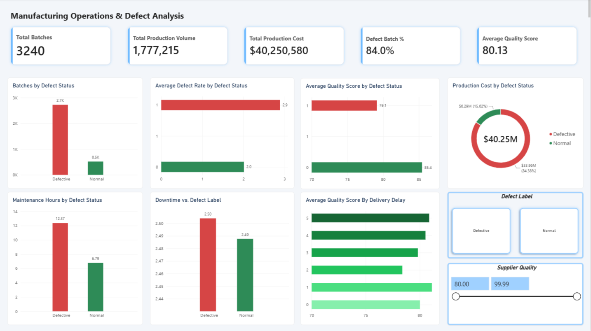

# Manufacturing Operations & Defect Analysis Dashboard

An executive Power BI analytics report engineered to evaluate batch manufacturing performance, isolate machine maintenance bottlenecks, and measure the financial cost of operational defects across 3,240 production runs.

---

## Executive Preview



---

## Key Operational Findings

1. **Maintenance Bottleneck Surge (+82.2%):**
   * Normal batches require an average of **6.79 maintenance hours**, whereas defective runs jump to **12.37 hours**.
   * Tool wear, calibration failure, and unoptimized maintenance cycles serve as the leading drivers of defect-related line delays.

2. **Capital Exposure ($33.96M at Risk):**
   * Out of **$40.25M** in total production costs, **$33.96M (84.4%)** is absorbed by defective batches across **1.78M** production units.

3. **Process Stability vs. Precision:**
   * Unplanned downtime percentage remains essentially flat between normal (~2.49%) and defective runs (~2.50%), showing that defect escalation is driven primarily by component precision tolerances rather than complete equipment line shutdowns.

---

## Project Architecture & Tech Stack

* **Business Intelligence:** Microsoft Power BI Desktop
* **Modeling & Metrics:** DAX (Data Analysis Expressions)
* **Data Processing & ETL:** Power Query, Microsoft Excel
* **Validation & Querying:** SQL

---

## Core DAX Measures

```dax
-- Total Batches Produced
Total Batches = COUNTROWS('clean_manufacturing_data')

-- Overall Batch Defect Percentage
Defect Batch % = 
DIVIDE(
    CALCULATE(COUNTROWS('clean_manufacturing_data'), 'clean_manufacturing_data'[DefectStatus] = 1),
    [Total Batches],
    0
)

-- Average Maintenance Hours
Avg Maintenance Hours = AVERAGE('clean_manufacturing_data'[MaintenanceHours])

-- Production Cost Allocation
Total Production Cost = SUM('clean_manufacturing_data'[ProductionCost])
